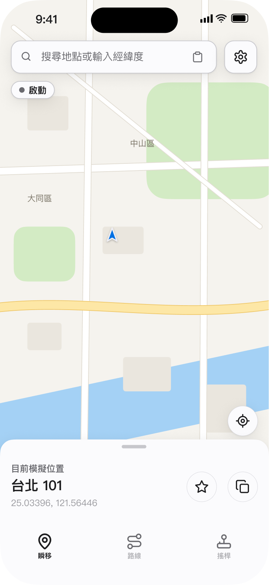
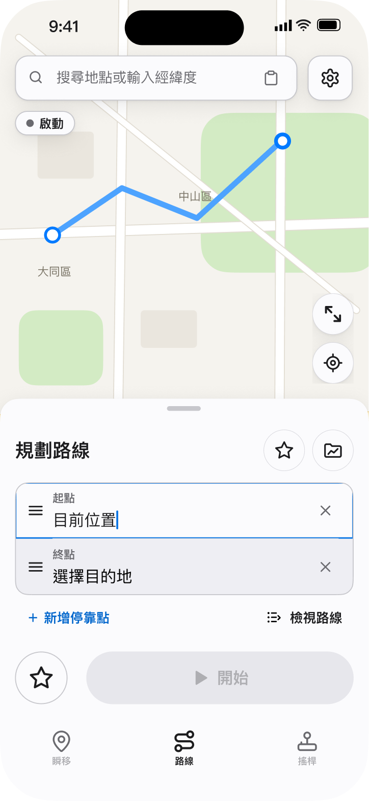
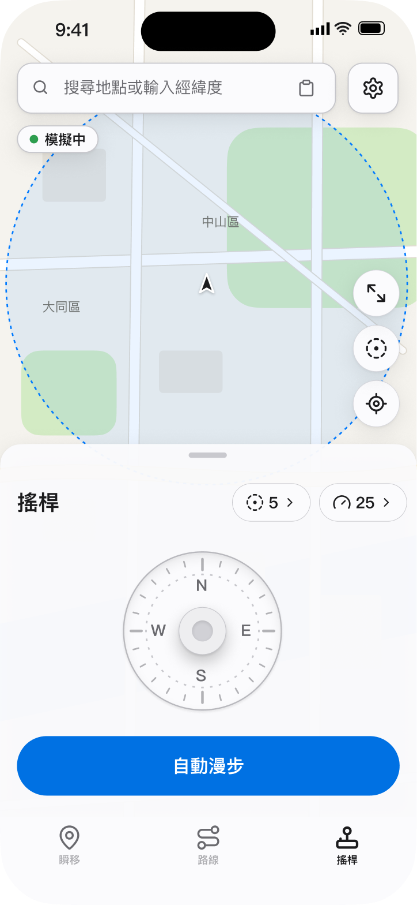
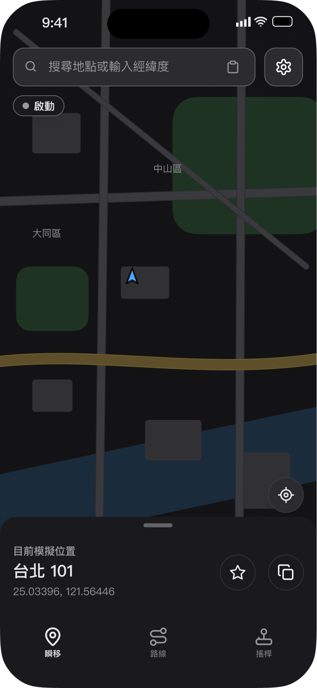
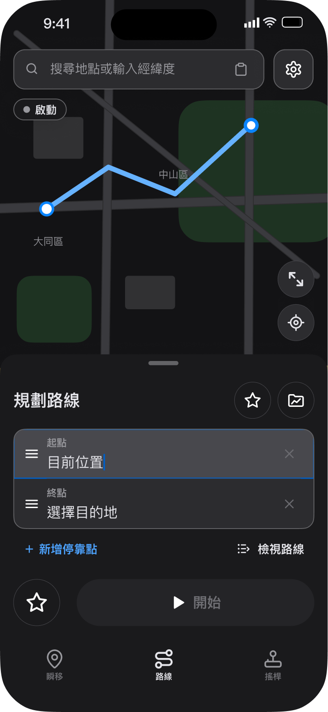
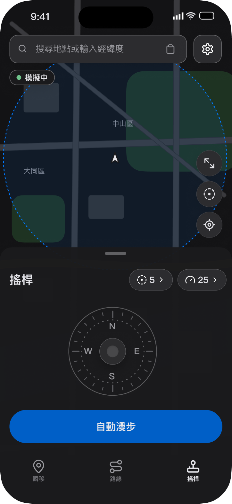

# GoFly

**English** · [繁體中文](README.zh-Hant.md) · [简体中文](README.zh-Hans.md)

GoFly is an iPhone app for choosing and moving a simulated GPS location on your own device. **GoFly for Mac** installs the iPhone app over USB with your own Apple Account in Xcode and renews its signing so you can keep using it.

[**Download the latest GoFly for Mac (DMG)**](https://github.com/nevenhsu/GoFly/releases/latest)

**Development status (2026-11-02): GoFly iOS app development is complete.** It supports installation through GoFly for Mac or as an IPA through SideStore / AltStore. Known limitations and remaining verification are listed below.

## What the iPhone app does

**Light**

<div style="overflow-x: auto; white-space: nowrap;">
  &nbsp;&nbsp;&nbsp;&nbsp;
</div>

<br>

**Dark**

<div style="overflow-x: auto; white-space: nowrap;">
  &nbsp;&nbsp;&nbsp;&nbsp;
</div>

<br>

- **Map and search** — find a place and jump to it; the map follows a Google Maps–style layout.
- **Teleport** — move the simulated location to a chosen point and hold it there.
- **Routes** — plan a route between points (including road routing), save it, import GPX files, and run it at walking, bicycle, scooter or car speed.
- **Joystick** — steer manually with an on-screen joystick.
- **Wander** — walk along roads automatically, with manual takeover.
- **Favorites and saved routes** — kept on the phone and preserved when the app is re-signed.
- **Session status and recovery** — a status pill shows connection state; the app reconnects automatically and lets you retry, stop, or **restore your real GPS**.
- **Languages** — English, Traditional Chinese and Simplified Chinese.

The device channel uses [LocalDevVPN](https://apps.apple.com/us/app/localdevvpn/id6755608044), installed separately from the App Store.

## What the Mac app does

GoFly for Mac is not a location tool. It builds the iPhone app with **your** Xcode signing Team, installs it on the iPhone you connect, hands over the pairing and device support the iPhone app needs, and confirms completion only after the iPhone reports back. Afterwards it can **renew signing** over USB or Wi-Fi, automatically when the signature is close to expiry while the Mac app is open. Existing app data is kept on renewal.

## Requirements

| Item | Requirement |
| --- | --- |
| Mac | Apple Silicon, macOS 15 or later (new enough for your Xcode). |
| Xcode | Full Xcode from the App Store with the iOS platform installed. GoFly guides you through this on a fresh Mac. |
| Apple Account | Your own, signed in under Xcode → Settings → Apple Accounts. A free Personal Team works. GoFly never sees your password. |
| iPhone | iOS 26 or later, unlocked, USB data cable for the first install, **Developer Mode** on, and this Mac trusted. |
| iPhone app | [LocalDevVPN](https://apps.apple.com/us/app/localdevvpn/id6755608044) installed and allowed to add a VPN. |
| Network | Needed for Apple signing and map search. |

Free Personal Team signing normally expires after about seven days; keep the Mac app open and it renews automatically, or press **Renew Signing**. Treat the expiry date shown in the Mac app as informational until you have verified it on your own device.

## Install (DMG)

1. Download `GoFly-<version>-arm64.dmg` and `GoFly-<version>-arm64.dmg.sha256` from the [latest release](https://github.com/nevenhsu/GoFly/releases/latest) into the same folder.
2. Verify the download. The result must be `OK`:

   ```sh
   shasum -a 256 -c GoFly-1.0.0-arm64.dmg.sha256
   ```
3. Open the DMG, then **run the installer from Terminal** (double-clicking `install.sh` is blocked by macOS):

   ```sh
   bash /Volumes/GoFly/install.sh
   ```

   It installs only `/Applications/GoFly.app`, asks before replacing an existing copy, removes the download quarantine from that app, and opens it. It does not use `sudo`, change Gatekeeper, or touch GoFly data. Type `y` and press **Enter** when asked.
4. In GoFly for Mac, follow the on-screen steps to prepare Xcode, then connect the iPhone by USB, trust the Mac, enable Developer Mode, and press **Install GoFly**.
5. On the iPhone, trust the developer (Settings → General → VPN & Device Management), install and allow LocalDevVPN, then open GoFly. The Mac app finishes when it reads back the iPhone's confirmation.

The app is ad-hoc signed, **not notarized**, so macOS will not open it by double-click; use the installer above. If you copy the app yourself, run `xattr -dr com.apple.quarantine /Applications/GoFly.app`.

## Install the IPA with SideStore or AltStore

If you'd rather not use the Mac app, [SideStore](https://sidestore.io) or [AltStore](https://altstore.io) can re-sign and install the IPA with your own Apple ID. Both use the same IPA; on first launch you import this iPhone's pairing file.

**Before you start**

- iPhone on iOS 26 or later with **Developer Mode** on.
- [LocalDevVPN](https://apps.apple.com/us/app/localdevvpn/id6755608044) installed and allowed to add a VPN; stay on Wi‑Fi while using GoFly.
- A computer with [iloader](https://github.com/nab138/iloader) to export this iPhone's pairing file (`pairingFile.plist`).

**Install**

1. Download `GoFly-<version>.ipa` from the [latest release](https://github.com/nevenhsu/GoFly/releases/latest) (check it with the matching `.sha256`) and move it to your iPhone.
2. Install it with one sideloading app:
   - **SideStore**: finish its [setup guide](https://docs.sidestore.io/docs/installation/install), keep Wi‑Fi and LocalDevVPN connected, then choose the IPA under **My Apps → +**.
   - **AltStore**: install AltServer on your computer and AltStore on your iPhone by following the [AltStore guide](https://faq.altstore.io/), then choose the IPA under **My Apps → +**.
3. A free Apple ID signature lasts about 7 days, so keep SideStore or AltStore refreshing GoFly. Refreshing keeps your GoFly data.

**First launch**

1. GoFly shows **Import pairing file**. Export this iPhone's pairing file with iloader on your computer, move it to the iPhone (AirDrop or the Files app), tap **Import**, and choose it.
2. Allow Location and Local Network, connect LocalDevVPN, and you're ready.

The pairing file must belong to this iPhone; a file for another phone is stopped at the first connection. The IPA does not need the Mac app; the Mac installer keeps its USB pairing flow. On 2026-11-02, import, teleport, background route movement, and positioning after an iPhone restart were verified on a device installed with SideStore; iOS occasionally suspends auto-wander in the background.

To build the unsigned IPA and SHA-256 file, run `bash app/GoFly/scripts/package-ipa.sh` (requires the prepared native archive under `work/gofly-ios/native`). Output always goes to `work/dist/ipa/`; an earlier IPA and checksum of the same version move to `work/dist/ipa/archive/<UTC time>/` instead of being overwritten or deleted. The Mac build is unchanged.

## Let an AI install it for you

Paste a GitHub link and this prompt into an AI assistant that can run shell commands (and, ideally, operate your Mac):

```text
Install GoFly for me from https://github.com/nevenhsu/GoFly.

1. Read README.md and docs/AI-INSTALL.md in that repository first.
2. Do not build from source. Download the newest release's
   GoFly-<version>-arm64.dmg and its .sha256 file into a new empty folder
   (for example with `gh release download`), run `shasum -a 256 -c` and stop
   if the result is not OK.
3. Mount the DMG and run `bash /Volumes/GoFly/install.sh` in Terminal. Do not
   double-click it, use sudo, or disable Gatekeeper. Answer the replace prompt
   only if I confirm.
4. Open GoFly for Mac and walk me through its steps. I will do Apple sign-in,
   2FA, the Keychain password prompt, iPhone trust, Developer Mode, the VPN
   permission and the LocalDevVPN install. Never ask me to paste passwords,
   pairing files or tokens into the chat.
5. Do not uninstall anything or delete app data. If something is interrupted,
   use the app's "Start over" instead of improvising.
6. Report what is done, what I still need to do on the iPhone, and any
   blocker. Installation success does not prove location simulation works;
   say that separately.
```

The full runbook for AI assistants is in [docs/AI-INSTALL.md](docs/AI-INSTALL.md).

## Troubleshooting

| Symptom | What to do |
| --- | --- |
| "Apple could not verify install.sh…" | Do not double-click. Run `bash /Volumes/GoFly/install.sh` in Terminal. |
| `/Volumes/GoFly/install.sh: No such file` | The DMG is not mounted, or an old one is. Eject GoFly in Finder and open the new DMG again. |
| `install.sh` seems stuck at the prompt | Type `y` **and press Enter**. |
| No iPhone appears | Use a data cable, unlock the phone, tap Trust, enable Developer Mode (needs a restart). |
| "The installation check failed" | Press **Check again**. If GoFly is already on the phone, open the device in the sidebar and use **Renew Signing**. |
| The iPhone app no longer opens | Signing expired. Renew from the Mac app; data is kept. |
| LocalDevVPN is on but GoFly cannot continue | Check the VPN is actually connected and allowed, then retry in GoFly. |

## Build from source

Only needed for development. On an Apple Silicon Mac with full Xcode:

```sh
bash app/GoFlyMac/make-dmg.sh <YOUR_XCODE_TEAM_ID>
```

This produces `work/dist/GoFly-<version>-arm64.dmg` and a `.sha256` file (not committed). See [app/GoFlyMac/README.md](app/GoFlyMac/README.md), [app/GoFly/README.md](app/GoFly/README.md) and [docs/MAC-INSTALLER-SPEC.md](docs/MAC-INSTALLER-SPEC.md).

## Status and limits

- Version 1 targets Apple Silicon Macs. Intel Macs, notarization and backup/restore are not included.
- Verification on a clean Mac and a long-running device soak are still pending; a successful install does not prove background behavior, reconnection or GPS restoration on every device. Test on your own iPhone and confirm your real location is restored afterwards.
- Use GoFly only on devices you own, and follow the laws and the terms of the apps you test with.

## Documentation

| Path | Purpose |
| --- | --- |
| [docs/AI-INSTALL.md](docs/AI-INSTALL.md) | Install runbook for AI assistants. |
| [docs/MAC-INSTALLER-SPEC.md](docs/MAC-INSTALLER-SPEC.md) | Mac app flow and behavior. |
| [docs/IOS-UI-DESIGN.md](docs/IOS-UI-DESIGN.md) | iOS UI design and acceptance. |
| [docs/LICENSING.md](docs/LICENSING.md) | Licenses and provenance. |

## License

Newly authored, independently owned material (the root READMEs and the guides under `docs/`) is **0BSD** — see [LICENSE](LICENSE). This does not relicense existing app code or dependencies. LocalGo/StikDebug-derived parts retain AGPL-3.0 notices, and the Mac app bundles GPL-3.0 `pymobiledevice3`, so a combined release is not wholly attribution-free. See [docs/LICENSING.md](docs/LICENSING.md) and [app/GoFly/Legal/SOURCES.txt](app/GoFly/Legal/SOURCES.txt). GoFly does not use or distribute AnyGo/iToolab code, assets or services.
