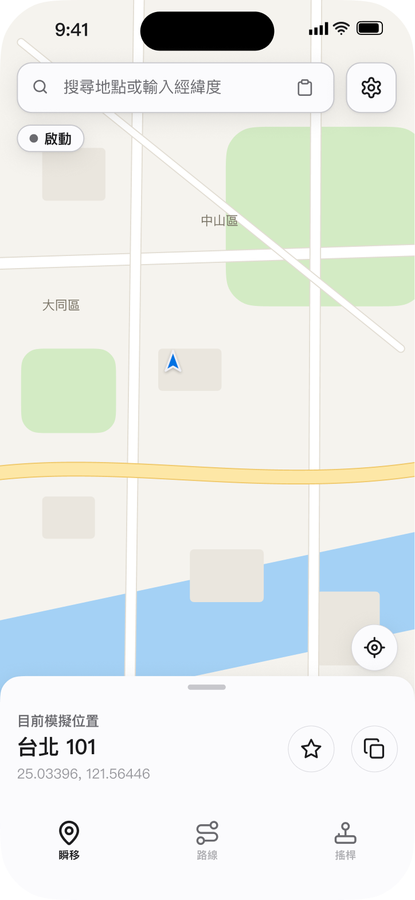
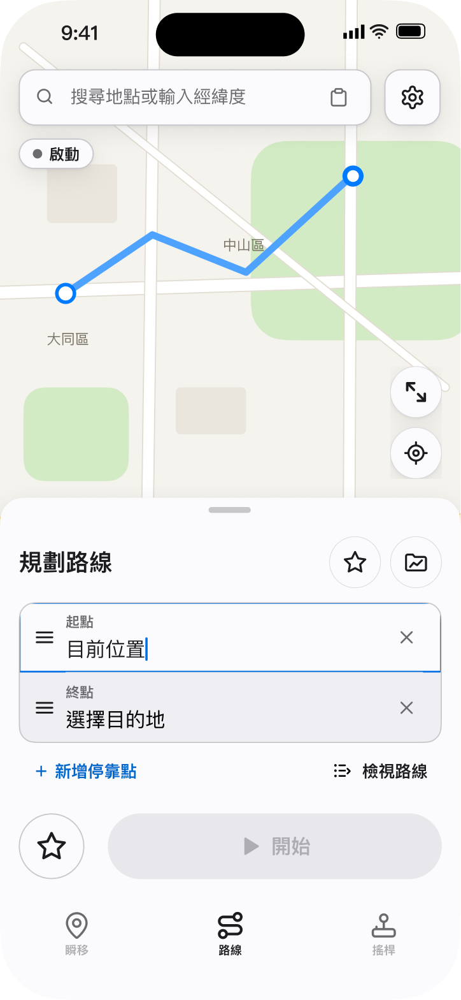
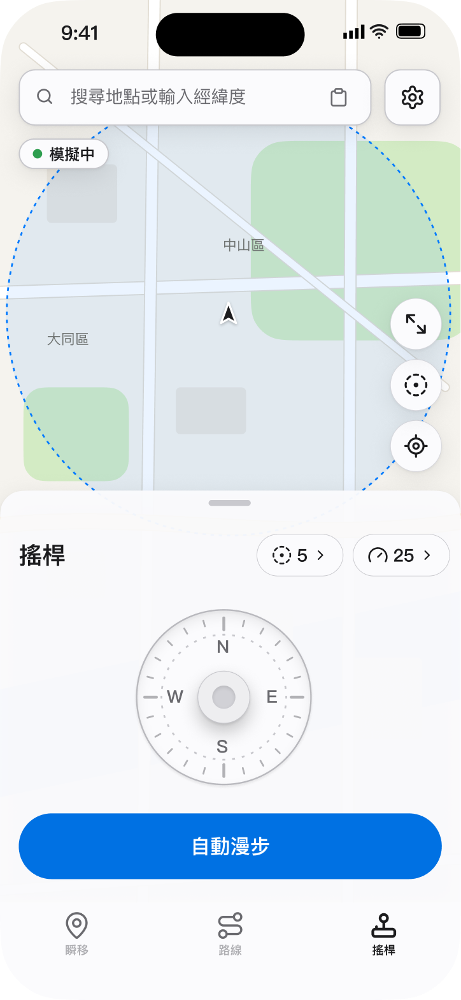
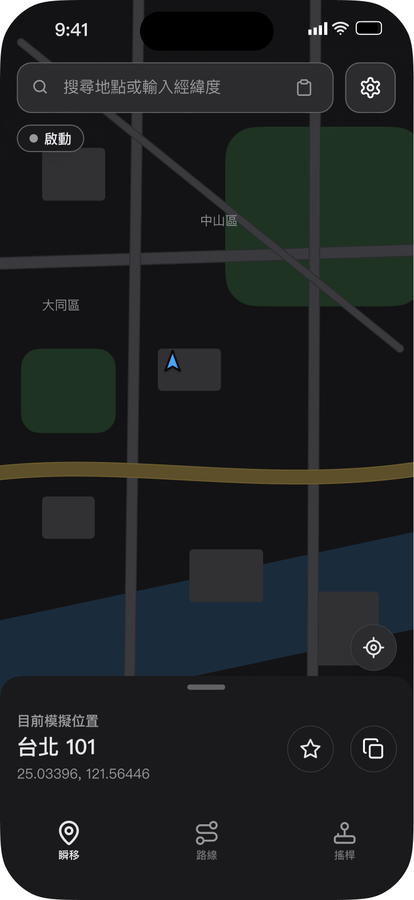
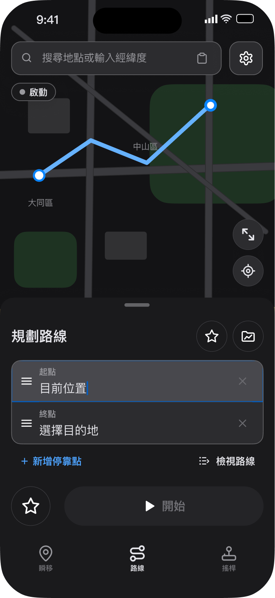
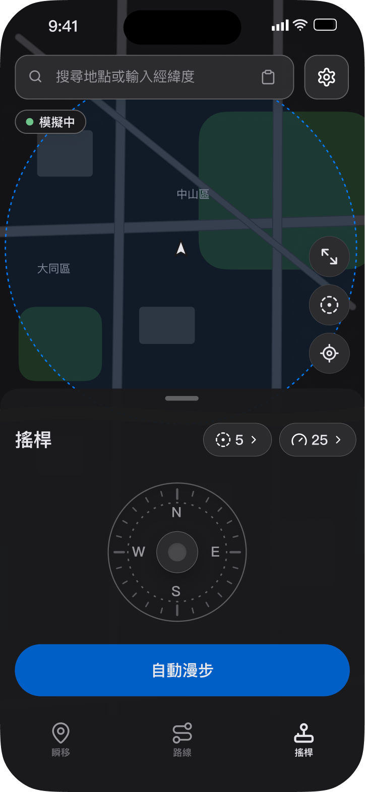

# GoFly GPS


**English** · [繁體中文](README.zh-Hant.md) · [简体中文](README.zh-Hans.md)

GoFly GPS is an iPhone app for choosing and moving a simulated GPS location on your own device. **GoFly GPS for Mac** installs the iPhone app over USB with your own Apple Account in Xcode and renews its signing so you can keep using it.

[**Download the latest GoFly GPS for Mac (DMG)**](https://github.com/nevenhsu/GoFly-GPS/releases/tag/v1.1.0)

**Development status (2026-11-02): GoFly GPS iOS app development is complete.** It supports installation through GoFly GPS for Mac or as an IPA through SideStore / AltStore. Known limitations and remaining verification are listed below.

## What the iPhone app does

**Light**

<div style="overflow-x: auto; white-space: nowrap;">
  &nbsp;&nbsp;&nbsp;&nbsp;
</div>

<br>

**Dark**

<div style="overflow-x: auto; white-space: nowrap;">
  &nbsp;&nbsp;&nbsp;&nbsp;
</div>

<br>

- **Map and search** — find a place and jump to it; the map follows a Google Maps–style layout.
- **Teleport** — move the simulated location to a chosen point and hold it there.
- **Routes** — plan a route between points (including road routing), save it, import GPX files, and run it at walking, bicycle, scooter or car speed.
- **Joystick** — steer manually with an on-screen joystick.
- **Wander** — walk along roads automatically, with manual takeover.
- **Favorites and saved routes** — kept on the phone and preserved when the app is re-signed.
- **Session status and recovery** — a status pill shows connection state; the app reconnects automatically and lets you retry, stop, or **restore your real GPS**.
- **Languages** — English, Traditional Chinese and Simplified Chinese.

The device channel uses [LocalDevVPN](https://apps.apple.com/us/app/localdevvpn/id6755608044), installed separately from the App Store.

## What the Mac app does

GoFly GPS for Mac is not a location tool. It builds the iPhone app with **your** Xcode signing Team, installs it on the iPhone you connect, hands over the pairing and device support the iPhone app needs, and confirms completion only after the iPhone reports back. Afterwards it can **renew signing** over USB or Wi-Fi, automatically when the signature is close to expiry while the Mac app is open. Existing app data is kept on renewal.

## Requirements

| Item | Requirement |
| --- | --- |
| Mac | Apple Silicon, macOS 15 or later (new enough for your Xcode). |
| Xcode | Full Xcode from the App Store with the iOS platform installed. GoFly GPS guides you through this on a fresh Mac. |
| Apple Account | Your own, signed in under Xcode → Settings → Apple Accounts. A free Personal Team works. GoFly GPS never sees your password. |
| iPhone | iOS 26 or later, unlocked, USB data cable for the first install, **Developer Mode** on, and this Mac trusted. |
| iPhone app | [LocalDevVPN](https://apps.apple.com/us/app/localdevvpn/id6755608044) installed and allowed to add a VPN. |
| Network | Needed for Apple signing and map search. |

Free Personal Team signing normally expires after about seven days; keep the Mac app open and it renews automatically, or press **Renew Signing**. Treat the expiry date shown in the Mac app as informational until you have verified it on your own device.

## Install (DMG)

1. Download `GoFly-GPS-<version>-arm64.dmg` and `GoFly-GPS-<version>-arm64.dmg.sha256` from the [latest Mac release](https://github.com/nevenhsu/GoFly-GPS/releases/tag/v1.1.0) into the same folder.
2. Verify the download. The result must be `OK`:

   ```sh
   shasum -a 256 -c GoFly-GPS-1.1.0-arm64.dmg.sha256
   ```
3. Open the DMG, then **run the installer from Terminal** (double-clicking `install.sh` is blocked by macOS):

   ```sh
   bash /Volumes/GoFly/install.sh
   ```

   It installs only `/Applications/GoFly.app`, asks before replacing an existing copy, removes the download quarantine from that app, and opens it. It does not use `sudo`, change Gatekeeper, or touch GoFly GPS data. Type `y` and press **Enter** when asked.
4. In GoFly GPS for Mac, follow the on-screen steps to prepare Xcode, then connect the iPhone by USB, trust the Mac, and enable Developer Mode. Select the latest IPA from GitHub or choose a local IPA with its matching `.ipa.sig`. After verification, install GoFly GPS.
5. On the iPhone, trust the developer (Settings → General → VPN & Device Management), install and allow LocalDevVPN, then open GoFly GPS. The Mac app finishes when it reads back the iPhone's confirmation.

The app is ad-hoc signed, **not notarized**, so macOS will not open it by double-click; use the installer above. If you copy the app yourself, run `xattr -dr com.apple.quarantine /Applications/GoFly.app`.

## Install the IPA with SideStore or AltStore

If you'd rather not use the Mac app, [SideStore](https://sidestore.io) or [AltStore](https://altstore.io) can re-sign and install the IPA with your own Apple ID. Both use the same IPA; on first launch you import this iPhone's pairing file. You can also [run GoFly inside LiveContainer](#run-gofly-gps-inside-livecontainer).

**Before you start**

- iPhone on iOS 26 or later with **Developer Mode** on.
- [LocalDevVPN](https://apps.apple.com/us/app/localdevvpn/id6755608044) installed and allowed to add a VPN; stay on Wi‑Fi while using GoFly GPS.
- A computer (and USB data cable) with [iloader](https://github.com/nab138/iloader/releases/latest) for installation and [idevice_pair](https://github.com/jkcoxson/idevice_pair/releases/latest) for pairing.

**Install (SideStore `.ipa` flow)**

1. Download `GoFly-GPS-<version>.ipa` and its matching `.sha256` from the [latest release](https://github.com/nevenhsu/GoFly-GPS/releases/latest), and verify the checksum (must print `OK`):

   ```sh
   shasum -a 256 -c GoFly-GPS-<version>.ipa.sha256
   ```

   Transfer the verified `.ipa` to your iPhone (AirDrop, iCloud Drive, or the Files app).
2. Set up [LiveContainer with built-in SideStore (Nightly)](#set-up-livecontainer-with-built-in-sidestore-nightly), or use the [standalone SideStore setup guide](https://docs.sidestore.io/docs/installation/install).
3. With Wi‑Fi and **LocalDevVPN** connected, open SideStore → **My Apps → +**, choose `GoFly-GPS-<version>.ipa`, and wait for re-signing and installation to finish (trust the developer profile in iOS Settings if prompted).
4. A free Apple ID signature lasts about 7 days. Keep Wi‑Fi and LocalDevVPN connected and refresh SideStore and GoFly GPS regularly; refreshing keeps your GoFly GPS data (do not uninstall).

If using **AltStore** instead: follow the [AltStore guide](https://faq.altstore.io/) to install AltServer on your computer and AltStore on your iPhone, then choose the verified `.ipa` under **My Apps → +** and keep it refreshed.

### Run GoFly GPS inside LiveContainer

1. Set up [LiveContainer + SideStore Nightly](#set-up-livecontainer-with-built-in-sidestore-nightly) and import the signing certificate. Use a GoFly IPA that includes the LiveContainer Local Network fix.
2. In **LiveContainer → Apps → +**, select the verified GoFly IPA. Open GoFly from the LiveContainer Apps list.
3. Connect **LocalDevVPN**, then follow the first-launch steps below. If iOS opens Settings at the Local Network step, enable **Settings → Privacy & Security → Local Network → LiveContainer**, return to GoFly, and tap **Allow** again if needed. If the pairing file picker does not open, enable **Fix File Picker** in GoFly’s settings inside LiveContainer. [LiveContainer install and compatibility guide](https://github.com/LiveContainer/LiveContainer#features--guides)

**Required LiveContainer app settings.** In LiveContainer, hold GoFly in **Apps** and open **Settings**. Turn on both **Fix Background Processing Tasks** (background routes and wandering) and **Fix File Picker** (pairing file import). Reopen GoFly and start a new run. [LiveContainer compatibility fix](https://github.com/LiveContainer/LiveContainer/issues/1710)

This IPA includes the LiveContainer Local Network fix. Full device validation for this release is pending.

### First launch of GoFly GPS

1. In idevice_pair, select this iPhone, choose **Remote Pairing**, and save the file. Transfer it to the iPhone, connect **LocalDevVPN**, then select the `.plist` or `.pairfile` in GoFly GPS under **Import pairing file**. Allow Local Network access if prompted and retry if the first check times out. You can use the same Remote Pairing export from the built-in SideStore setup below.
2. Allow Location and Local Network, and connect LocalDevVPN. If GoFly GPS prompts to download device support (DDI), follow the on-screen prompt while online and you're ready.

GoFly verifies a Remote Pairing export without a device UDID through LocalDevVPN before saving it. The import flow is pending device validation in this release. The IPA does not need the Mac app; the Mac installer keeps its USB pairing flow. On 2026-11-02, import, teleport, background route movement, and positioning after an iPhone restart were verified on a device installed with SideStore; auto-wander in the background was fixed and device-tested (when a segment ends in the background it keeps running in place while the next road is planned, instead of pausing).

To build the unsigned IPA and SHA-256 file, run `bash app/GoFly/scripts/package-ipa.sh` on a Mac with Xcode in `/Applications/Xcode.app` and internet access. On the first run (or after the native pin changes) it fetches the pinned idevice commit, downloads the checksum-verified Rust toolchain, and builds the native library under `work/gofly-ios/`; later runs reuse it. Output always goes to `work/dist/ipa/`; an earlier IPA and checksum of the same version move to `work/dist/ipa/archive/<UTC time>/` instead of being overwritten or deleted. The Mac build is unchanged.

### Set up LiveContainer with built-in SideStore (Nightly)

Download the latest [iloader](https://github.com/nab138/iloader/releases/latest) and [idevice_pair](https://github.com/jkcoxson/idevice_pair/releases/latest) on your computer, and install [LocalDevVPN](https://apps.apple.com/us/app/localdevvpn/id6755608044) on your iPhone. Remote Pairing requires iOS 17.4 or later. GoFly GPS still requires iOS 26 or later.

#### Install the Nightly

1. Back up any existing LiveContainer data before updating. Keep the original app installed.
2. Connect the iPhone over USB, unlock it, and tap **Trust** if prompted.
3. Open iloader, select the iPhone, sign in with your Apple ID, and install **LiveContainer + SideStore (Nightly)**. See the [official installation guide](https://livecontainer.github.io/docs/installation/lc_sidestore#method-2-iloader).
4. On the iPhone, trust the developer in **Settings → General → VPN & Device Management** and follow any restart prompt. If needed, enable **Developer Mode** in **Settings → Privacy & Security** and restart as prompted.

#### Create and import a Remote Pairing file with idevice_pair

1. Force-close LiveContainer. Keep the iPhone connected over USB, unlocked, and on the Home Screen.
2. In **idevice_pair**, select the iPhone and choose **Remote Pairing** (**RPPairing**). Click **Create** and follow the prompts. Click **Validate** to confirm it works, then **Save to file…** and transfer the file to the iPhone.
3. Open the built-in SideStore from LiveContainer. Select the new file in the pairing prompt or import it under **Settings → Pairing File Management → Remote Pairing File**.
4. If **Set as Preferred** appears, select it for Remote Pairing. Force-close and reopen LiveContainer.

Use a Remote Pairing-only file here to avoid format detection errors such as `The pairing file format is ambiguous`. [SideStore pairing report #1611](https://github.com/SideStore/SideStore/issues/1611)

#### Configure Anisette before signing in

The GoFly maintainer encountered HTTP 403 followed by HTTP 503 in built-in SideStore and signed in successfully after applying both fixes in this order. Server-side changes can still affect sign-in.

1. For **HTTP 403**, switch to remote Anisette and sync its settings. In built-in SideStore, open **Settings → User Customizations** and turn off **On-Device Anisette**. Force-close and reopen LiveContainer if prompted.
2. Open **Settings → Anisette Servers** and choose a working remote server. You can keep the default if it works.
3. Go to **Settings → User Customizations → Anisette Client Configuration → Remote Server Sync**. Click **Fetch** and, once it succeeds, click **Save as Overrides**. The SideStore community also reported this workaround for HTTP 401. [401 report #1752](https://github.com/SideStore/SideStore/issues/1752)
4. For **HTTP 503**, check **Client Info**. Change only `macOS;` to `Mac OS X;` if present, preserving the device model, version and parenthesized text. If it already says `Mac OS X;`, keep it. Click **Save Overrides**, then force-close and reopen LiveContainer. [503 report #1749](https://github.com/SideStore/SideStore/issues/1749)

Fetch and save first, then check **Client Info** again after every fetch because syncing can overwrite it.

#### Sign in, refresh and import the certificate

1. Sign in to built-in SideStore with the same Apple ID you used in iloader and complete two-factor authentication.
2. Connect **LocalDevVPN**, then open **My Apps → Refresh All** in built-in SideStore and confirm the refresh succeeds.
3. Quit built-in SideStore. In LiveContainer, go to **Settings → Import Certificate from SideStore** and confirm. The button changes to **Remove Certificate** when the import succeeds.
4. Open **JIT-Less Mode Diagnose** to confirm the setup status. [Official post-install setup](https://livecontainer.github.io/docs/installation/lc_sidestore#setup-after-installing)

## Refresh built-in SideStore every evening

### 1. Create the Refresh All Apps shortcut manually (official steps)

1. In the Shortcuts app, create a new shortcut.
2. Tap **Search Actions** and search for **LiveContainer**.
3. Add **Refresh All Apps**. If the action is missing, open SideStore from inside LiveContainer once and search again. [LiveContainer auto-refresh guide](https://livecontainer.github.io/docs/installation/lc_sidestore#auto-refresh-shortcut)

### 2. Create the automation with a prompt

In the Shortcuts app, open **Automation**, create a new automation and paste this prompt:

```text
Create an automation shortcut named "LiveContainer Auto Re-sign".
1. Every day at 10:00 PM.
2. Get the name (SSID) of the connected Wi‑Fi network. If no name is returned, stop the shortcut.
3. Turn on the VPN with the LocalDevVPN connect action, then wait 5 seconds.
4. Run the "Refresh All Apps" action
   so LiveContainer's built-in SideStore re-signs and refreshes the apps.
```

The Refresh All Apps action already shows its own notification, so the automation does not add one.

After creating the automation, run it manually once. iOS asks you to confirm that the automation may run another shortcut (Refresh All Apps); allow it, or the scheduled run cannot call it. Then try a scheduled run with the iPhone locked. LiveContainer has a reported issue where the refresh action can fail if the built-in SideStore has not been opened. [LiveContainer issue #1572](https://github.com/LiveContainer/LiveContainer/issues/1572)

## Add a LiveContainer app to the Home Screen

### 1. Prepare

- In LiveContainer, long-press the app (for example GoFly GPS), choose **Save App Icon** and save it to iCloud Drive.
- Long-press the app again and choose **Copy Launch URL**.

### 2. Create the iOS shortcut

- Open the Shortcuts app and tap **+** in the top-right corner to create a shortcut.
- Search for and add **Launch App**. This action is provided by LiveContainer and requires the `LaunchAppExtension` extension to be enabled when you install LiveContainer.
- Tap the field in the action and paste the launch URL you copied. [LiveContainer guide](https://livecontainer.github.io/docs/guides/add-to-home-screen)
- Tap the shortcut name at the top and rename it to the app name (for example GoFly GPS).

### 3. Add it to the Home Screen and set the icon

- Tap the share button at the bottom of the shortcut and choose **Add to Home Screen**.
- Tap the default icon, choose **Choose File**, pick the app icon you saved, rename it to match the app, and tap **Add**.

## Let an AI install it for you

Paste a GitHub link and one of the prompts below into an AI assistant that can run shell commands (and, ideally, operate your computer):

**Install via the Mac app (DMG):**

```text
Install GoFly GPS for me from https://github.com/nevenhsu/GoFly-GPS.

1. Read README.md and docs/AI-INSTALL.md in that repository first.
2. Do not build from source. Download the newest release's
   GoFly-GPS-<version>-arm64.dmg and its .sha256 file into a new empty folder
   (for example with `gh release download`), run `shasum -a 256 -c` and stop
   if the result is not OK.
3. Mount the DMG and run `bash /Volumes/GoFly/install.sh` in Terminal. Do not
   double-click it, use sudo, or disable Gatekeeper. Answer the replace prompt
   only if I confirm.
4. Open GoFly GPS for Mac and walk me through its steps. I will do Apple sign-in,
   2FA, the Keychain password prompt, iPhone trust, Developer Mode, the VPN
   permission and the LocalDevVPN install. Never ask me to paste passwords,
   pairing files or tokens into the chat.
5. Do not uninstall anything or delete app data. If something is interrupted,
   use the app's "Start over" instead of improvising.
6. Report what is done, what I still need to do on the iPhone, and any
   blocker. Installation success does not prove location simulation works;
   say that separately.
```

**Install the `.ipa` via SideStore:**

```text
Help me install GoFly GPS on my iPhone via SideStore from https://github.com/nevenhsu/GoFly-GPS.

1. Read README.md and docs/AI-INSTALL.md in that repository first.
2. Do not build from source. Download the latest release's GoFly-GPS-<version>.ipa
   and its .sha256 file into a new empty folder, run `shasum -a 256 -c`, and stop
   if the result is not OK.
3. Walk me through the README's LiveContainer + SideStore Nightly setup, using
   idevice_pair for Remote Pairing and configuring Anisette before sign-in.
   Then help me install the GoFly GPS IPA via SideStore (My Apps -> +) and import
   this iPhone's Remote Pairing file on first launch of GoFly GPS.
4. If Apple ID sign-in fails, use the README troubleshooting entry for the app
   showing the error (desktop iloader or built-in SideStore).
5. I will handle Apple ID sign-in, 2FA, iPhone trust, Developer Mode, and VPN
   permissions myself. Never ask for passwords, pairing files, or tokens in chat.
6. Report what is done, what I still need to do on the iPhone, and any
   blocker. Installation success does not prove location simulation works;
   say that separately.
```

The full runbook for AI assistants is in [docs/AI-INSTALL.md](docs/AI-INSTALL.md).

## Troubleshooting

| Symptom | What to do |
| --- | --- |
| "Apple could not verify install.sh…" | Do not double-click. Run `bash /Volumes/GoFly/install.sh` in Terminal. |
| `/Volumes/GoFly/install.sh: No such file` | The DMG is not mounted, or an old one is. Eject the `GoFly GPS` volume in Finder and open the new DMG again. |
| `install.sh` seems stuck at the prompt | Type `y` **and press Enter**. |
| No iPhone appears | Use a data cable, unlock the phone, tap Trust, enable Developer Mode (needs a restart). |
| "The installation check failed" | Press **Check again**. If GoFly GPS is already on the phone, open the device in the sidebar and use **Renew Signing**. |
| The iPhone app no longer opens | Signing expired. Renew from the Mac app or SideStore / AltStore; data is kept. |
| LocalDevVPN is on but GoFly GPS cannot continue | Check the VPN is actually connected and allowed, then retry in GoFly GPS. |
| GoFly in LiveContainer shows “Background mode declined” | In LiveContainer, hold **GoFly GPS** on the **Apps** tab, tap **Settings**, then turn on **Fix Background Processing Tasks**. Reopen GoFly and start the route or wander again. If the switch is missing, update [LiveContainer Nightly](https://github.com/LiveContainer/LiveContainer/releases/tag/nightly). |
| Built-in SideStore sign-in shows HTTP 403 | Turn off **On-Device Anisette**, select a working remote server, then use **Fetch → Save as Overrides** before checking Client Info. [Anisette setup](#configure-anisette-before-signing-in) |
| Built-in SideStore sign-in shows HTTP 503 | Fetch and save first, then check **Client Info** and change only `macOS;` to `Mac OS X;`. [Anisette setup](#configure-anisette-before-signing-in) |
| Apple ID sign-in fails in desktop iloader | iloader 2.4.1 may return HTTP 503, and 2.4.2 may return `-22410` or `-23782` on some accounts. The GoFly maintainer used a self-built copy from [iloader PR #1205](https://github.com/nab138/iloader/pull/1205). You can also wait for an [official iloader release](https://github.com/nab138/iloader/releases/latest) with the sign-in fix. |
| SideStore shows “Operation Failed … unable to reach the device endpoint … `DeviceEndpointNotInitialized`” when installing or refreshing | LocalDevVPN shows connected but SideStore can't reach the iPhone through it. **Restart your iPhone**, reconnect Wi‑Fi and LocalDevVPN, then try again in SideStore. |

## Build from source

Only needed for development. On an Apple Silicon Mac with full Xcode:

```sh
bash app/GoFlyMac/make-dmg.sh <YOUR_XCODE_TEAM_ID>
```

This produces `work/dist/GoFly-GPS-<version>-arm64.dmg` and a `.sha256` file (not committed). See [app/GoFlyMac/README.md](app/GoFlyMac/README.md), [app/GoFly/README.md](app/GoFly/README.md) and [docs/MAC-INSTALLER-SPEC.md](docs/MAC-INSTALLER-SPEC.md).

## Status and limits

- Version 1 targets Apple Silicon Macs. Intel Macs, notarization and backup/restore are not included.
- Verification on a clean Mac and a long-running device soak are still pending; a successful install does not prove background behavior, reconnection or GPS restoration on every device. Test on your own iPhone and confirm your real location is restored afterwards.
- Use GoFly GPS only on devices you own, and follow the laws and the terms of the apps you test with.

## Documentation

| Path | Purpose |
| --- | --- |
| [docs/AI-INSTALL.md](docs/AI-INSTALL.md) | Install runbook for AI assistants. |
| [docs/MAC-INSTALLER-SPEC.md](docs/MAC-INSTALLER-SPEC.md) | Mac app flow and behavior. |
| [docs/IOS-UI-DESIGN.md](docs/IOS-UI-DESIGN.md) | iOS UI design and acceptance. |
| [docs/LICENSING.md](docs/LICENSING.md) | Licenses and provenance. |

## License

Newly authored, independently owned material (the root READMEs and the guides under `docs/`) is **0BSD** — see [LICENSE](LICENSE). This does not relicense existing app code or dependencies. LocalGo/StikDebug-derived parts retain AGPL-3.0 notices, and the Mac app bundles GPL-3.0 `pymobiledevice3`, so a combined release is not wholly attribution-free. See [docs/LICENSING.md](docs/LICENSING.md) and [app/GoFly/Legal/SOURCES.txt](app/GoFly/Legal/SOURCES.txt). GoFly GPS does not use or distribute AnyGo/iToolab code, assets or services.
