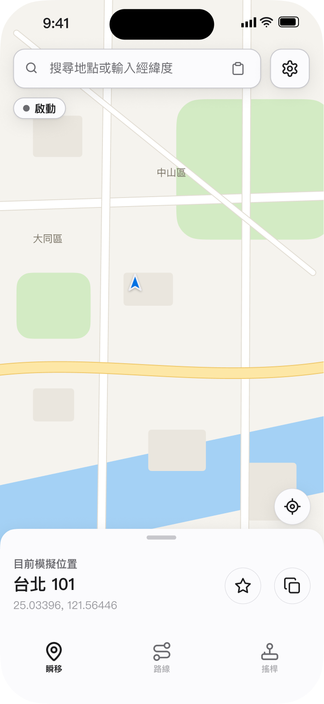
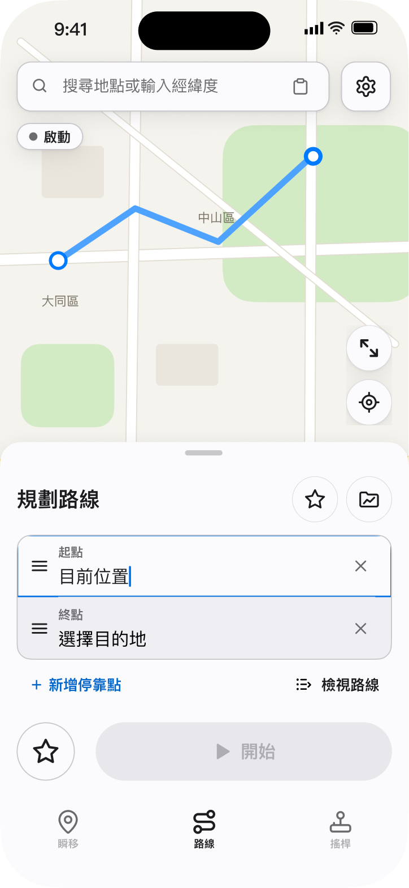
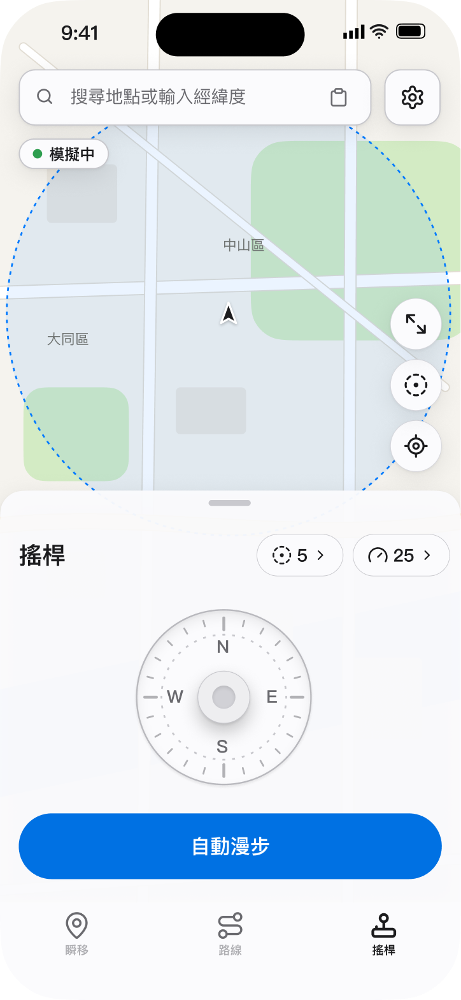
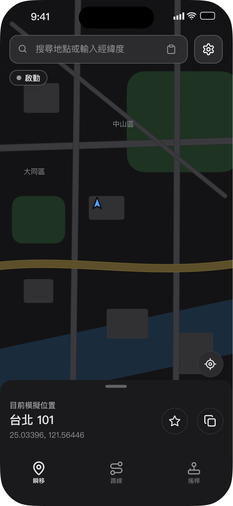
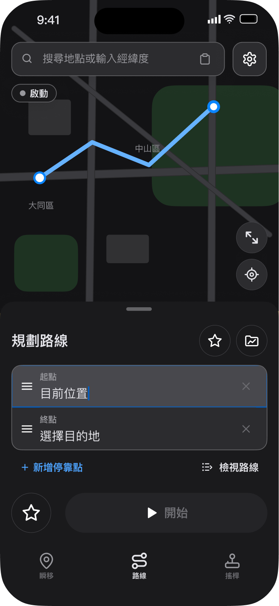
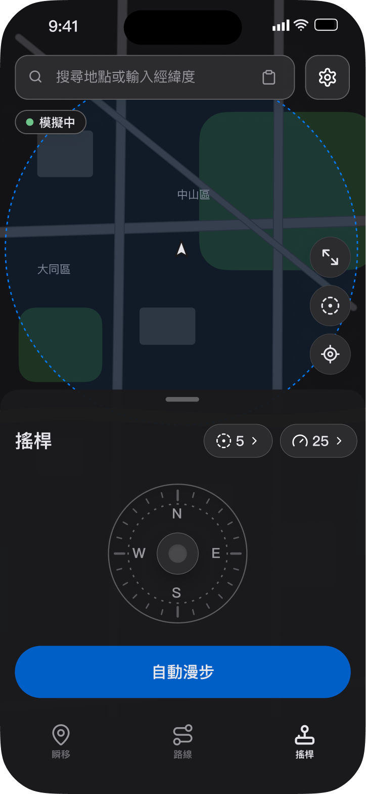

# GoFly GPS


[English](README.md) · [繁體中文](README.zh-Hant.md) · **简体中文**

GoFly GPS 是一个让你在自己的 iPhone 上选择并移动模拟 GPS 位置的 App。**GoFly GPS for Mac** 使用你在 Xcode 登录的 Apple 账号，通过 USB 安装 iPhone App，并可更新签名，让 App 持续可用。

[**下载最新版 GoFly GPS for Mac（DMG）**](https://github.com/nevenhsu/GoFly-GPS/releases/tag/v1.0.12)

**开发状态（2026-11-02）：GoFly GPS iOS App 已开发完成。** 可通过 GoFly GPS for Mac 安装，或使用 SideStore／AltStore 安装 IPA。已知限制与尚待验证项目见下方说明。

## iPhone App 的功能

**Light 外观**

<div style="overflow-x: auto; white-space: nowrap;">
  &nbsp;&nbsp;&nbsp;&nbsp;
</div>

**Dark 外观**

<div style="overflow-x: auto; white-space: nowrap;">
  &nbsp;&nbsp;&nbsp;&nbsp;
</div>

<br>

- **地图与搜索**：搜索地点并跳转过去，界面参考 Google Maps 的版面。
- **瞬移**：把模拟位置移到指定的点，并保持在那里。
- **路线**：在多个点之间规划路线（含道路路线）、保存、导入 GPX，并以步行、自行车、摩托车或汽车的速度执行。
- **摇杆**：用屏幕上的摇杆手动操控移动。
- **漫步**：沿着道路自动行走，可随时手动接管。
- **收藏与已存路线**：保存在手机上，重新签名时数据会保留。
- **状态与恢复**：状态胶囊显示连接状态；App 会自动重新连接，也可手动重试、停止或**还原真实 GPS**。
- **语言**：英文、繁体中文、简体中文。

设备通道使用 [LocalDevVPN](https://apps.apple.com/us/app/localdevvpn/id6755608044)，需另外从 App Store 安装。

## Mac App 的功能

GoFly GPS for Mac 不是定位工具。它用**你的** Xcode 签名 Team 构建 iPhone App、安装到你连接的 iPhone、交付 iPhone App 需要的配对与设备支持，并且要等 iPhone 回报后才显示完成。之后可以通过 USB 或 Wi‑Fi **延长签名**；Mac App 开着时，签名快到期会自动延长。延长签名时 App 内的数据会保留。

## 需求

| 项目 | 需求 |
| --- | --- |
| Mac | Apple Silicon，macOS 15 以上（需符合你 Xcode 的要求）。 |
| Xcode | 从 App Store 安装完整 Xcode 并下载 iOS 平台。全新 Mac 上 GoFly GPS 会逐步引导。 |
| Apple 账号 | 你自己的账号，在 Xcode → Settings → Apple Accounts 登录。免费 Personal Team 即可。GoFly GPS 不会获取你的密码。 |
| iPhone | iOS 26 以上、已解锁；首次安装需 USB 数据线、开启**开发者模式**，并信任这台 Mac。 |
| iPhone App | 已安装 [LocalDevVPN](https://apps.apple.com/us/app/localdevvpn/id6755608044) 并允许添加 VPN。 |
| 网络 | Apple 签名与地图搜索需要。 |

免费 Personal Team 的签名通常约七天到期；让 Mac App 保持打开会自动延长，也可按 **Renew Signing**。Mac App 显示的到期日在你于自己的设备验证前，仅供参考。

## 安装（DMG）

1. 到[最新版 Release](https://github.com/nevenhsu/GoFly-GPS/releases/tag/v1.0.12)，把 `GoFly-GPS-<版本>-arm64.dmg` 与 `GoFly-GPS-<版本>-arm64.dmg.sha256` 下载到同一个文件夹。
2. 核对下载文件，结果必须是 `OK`：

   ```sh
   shasum -a 256 -c GoFly-GPS-1.0.6-arm64.dmg.sha256
   ```
3. 打开 DMG，然后**在“终端”运行安装脚本**（macOS 会拦下双击 `install.sh`）：

   ```sh
   bash /Volumes/GoFly/install.sh
   ```

   它只会安装 `/Applications/GoFly.app`，已有旧版时会先询问，并移除该 App 的下载隔离属性后打开。不使用 `sudo`、不改动 Gatekeeper、不动 GoFly GPS 的数据。出现提示时输入 `y` 并按 **Enter**。
4. 在 GoFly GPS for Mac 按画面步骤准备 Xcode，然后用 USB 连接 iPhone、信任这台 Mac、开启开发者模式，按**安装 GoFly GPS**。
5. 在 iPhone 上信任开发者（设置 › 通用 › VPN 与设备管理）、安装并允许 LocalDevVPN，再打开 GoFly GPS。Mac App 读回 iPhone 的确认后才算完成。

这个 App 使用 ad-hoc 签名、**未经公证**，所以不能直接双击打开，请用上面的安装脚本。若你自己拖动 App，请运行 `xattr -dr com.apple.quarantine /Applications/GoFly.app`。

## 用 SideStore 或 AltStore 安装 IPA

不想用 Mac App 时，可以用 [SideStore](https://sidestore.io) 或 [AltStore](https://altstore.io) 以你自己的 Apple ID 重新签名并安装 IPA。两者使用同一份 IPA，第一次打开时要导入这台 iPhone 的配对文件。 也可以[在 LiveContainer 内运行 GoFly](#在-livecontainer-内运行-gofly-gps)。

**准备**

- iPhone：iOS 26 以上，已打开**开发者模式**。
- 已安装 [LocalDevVPN](https://apps.apple.com/us/app/localdevvpn/id6755608044) 并允许添加 VPN；使用 GoFly GPS 时连接 Wi‑Fi。
- 一台有 USB 数据线的电脑，安装 [iloader](https://github.com/nab138/iloader/releases/latest) 和 [idevice_pair](https://github.com/jkcoxson/idevice_pair/releases/latest)，用于安装与配对。

**安装（SideStore `.ipa` 流程）**

1. 从[最新版 Release](https://github.com/nevenhsu/GoFly-GPS/releases/latest)下载 `GoFly-GPS-<版本>.ipa` 与同名 `.sha256`，核对校验码（结果须为 `OK`）：

   ```sh
   shasum -a 256 -c GoFly-GPS-<版本>.ipa.sha256
   ```

   核对无误后，把 `.ipa` 传到 iPhone（AirDrop、iCloud 云盘或“文件”App）。
2. 按下方[流程设置 LiveContainer 与内置 SideStore Nightly](#livecontainer-与内置-sidestore-nightly-安装设置)，或参考[独立版 SideStore 官方安装说明](https://docs.sidestore.io/docs/installation/install)。
3. 确认 Wi‑Fi 与 **LocalDevVPN** 仍保持连接，在 SideStore 的 **My Apps → ＋** 选择刚传入的 `GoFly-GPS-<版本>.ipa`，等待重新签名与安装完成（若系统要求，请到“设置 › 通用 › VPN 与设备管理”信任开发者）。
4. 免费 Apple ID 的签名约 7 天，请保持 Wi‑Fi 与 LocalDevVPN 连接，定期在 SideStore 刷新 SideStore 与 GoFly GPS；刷新会保留 App 内的数据，请勿卸载。

若改用 **AltStore**：按 [AltStore 说明](https://faq.altstore.io/)在电脑安装 AltServer、在 iPhone 安装 AltStore，同样在 **My Apps → ＋** 选择已核对的 `.ipa` 安装，并定期刷新。

### 在 LiveContainer 内运行 GoFly GPS

1. 完成 [LiveContainer 与内置 SideStore Nightly 设置](#livecontainer-与内置-sidestore-nightly-安装设置)并导入签名证书。请使用包含 LiveContainer 本地网络修复的 GoFly IPA。
2. 在 **LiveContainer → Apps → ＋** 选择已校验的 GoFly IPA，完成后从 LiveContainer 的 Apps 列表打开 GoFly。
3. 先连接 **LocalDevVPN**，再按下方步骤导入配对文件并完成引导。如果本地网络步骤跳到设置，请到 **设置 → 隐私与安全性 → 本地网络 → LiveContainer** 开启权限，返回 GoFly，必要时再点一次 **Allow**。如果配对文件选择器打不开，在 LiveContainer 内 GoFly 的单独设置中启用 **Fix File Picker**。[LiveContainer 安装和兼容性说明](https://github.com/LiveContainer/LiveContainer#features--guides)

**后台路线与漫步。** 在 LiveContainer 的 **Apps** 长按 GoFly，打开 **Settings** 并启用 **Fix Background Processing Tasks**（修复后台处理任务）。重新打开 GoFly，再启动一次路线或漫步。[LiveContainer 兼容性修复](https://github.com/LiveContainer/LiveContainer/issues/1710)

本版 IPA 包含 LiveContainer 本地网络修复，仍待本版完整真机验证。

### 第一次打开 GoFly GPS

1. 在 idevice_pair 选择这台 iPhone，选择 **Remote Pairing** 并保存文件。传到 iPhone 后，先连接 **LocalDevVPN**，再到 GoFly GPS 点**导入配对文件**，选择 `.plist` 或 `.pairfile`。若出现本地网络权限提示，请允许，首次检查超时可以重试。下方内置 SideStore 步骤导出的同一份 Remote Pairing 文件也可使用。
2. 依次允许定位与本地网络，并连接 LocalDevVPN；若 App 提示下载设备支持（DDI），保持网络连接按画面提示完成即可开始使用。

Remote Pairing 文件若未包含设备 UDID，GoFly 会通过 LocalDevVPN 验证这台 iPhone 后才保存。本版的配对文件导入流程尚待真机验证。IPA 版不需要 Mac App；Mac 安装版仍使用原来的 USB 配对流程。2026-11-02 已用 SideStore 实机验证导入、瞬移、路线后台移动，以及手机重启后的定位；已修正自动漫步在后台运行的问题（后台中一段走完时，原地等待下一条道路规划完成，不再暂停），已实机测试成功。

### LiveContainer 与内置 SideStore Nightly 安装设置

在电脑下载最新版 [iloader](https://github.com/nab138/iloader/releases/latest) 和 [idevice_pair](https://github.com/jkcoxson/idevice_pair/releases/latest)，并在 iPhone 安装 [LocalDevVPN](https://apps.apple.com/us/app/localdevvpn/id6755608044)。Remote Pairing 需要 iOS 17.4 或更新版。GoFly GPS 仍需要 iOS 26 或更新版。

#### 安装 Nightly

1. 若已有 LiveContainer 数据，先备份并保留原 App。
2. 用 USB 将 iPhone 连接到电脑，解锁后按提示点击“信任这台电脑”。
3. 打开 iloader，选择 iPhone，登录 Apple ID，安装 **LiveContainer + SideStore（Nightly）**。[官方安装说明](https://livecontainer.github.io/docs/installation/lc_sidestore#method-2-iloader)
4. 在 iPhone 的“设置 → 通用 → VPN 与设备管理”信任开发者，并按提示重启。若尚未启用开发者模式，到“设置 → 隐私与安全性 → 开发者模式”启用并按提示重启。

#### 使用 idevice_pair 建立并导入 Remote Pairing 配对文件

1. 完全关闭 LiveContainer。保持 USB 连接，让 iPhone 解锁并停在主屏幕。
2. 在 **idevice_pair** 选择 iPhone，选择 **Remote Pairing／RPPairing**，点 **Create** 并按提示完成配对。点 **Validate** 确认成功，再点 **Save to file…** 保存并将文件传到 iPhone。
3. 打开 LiveContainer 的内置 SideStore，在配对提示中选择新文件，或从 **Settings → Pairing File Management → Remote Pairing File** 导入。
4. 若显示 **Set as Preferred**，将 Remote Pairing 设为首选协议。完全关闭 LiveContainer，再打开。

导入只包含 Remote Pairing 的配对文件，可避免混合格式引发的识别问题，例如 `The pairing file format is ambiguous`。[SideStore 配对报告 #1611](https://github.com/SideStore/SideStore/issues/1611)

#### 登录前设置 Anisette

GoFly 维护者在内置 SideStore 登录时先遇到 HTTP 403，接着遇到 HTTP 503。按顺序完成以下两段设置后成功登录。服务器端变化仍可能影响登录。

1. **HTTP 403｜关闭设备端 Anisette 并同步远程设置。** 在内置 SideStore 打开 **Settings → User Customizations**，关闭 **On-Device Anisette**。若有重启提示，完全关闭 LiveContainer 后重新打开。
2. 前往 **Settings → Anisette Servers**，选择可用的远程服务器。默认服务器可用时也可保留。
3. 前往 **Settings → User Customizations → Anisette Client Configuration → Remote Server Sync**，点 **Fetch**，成功后点 **Save as Overrides**。SideStore 社区也曾报告用这组设置处理 401。[401 报告 #1752](https://github.com/SideStore/SideStore/issues/1752)
4. **HTTP 503｜检查 Client Info。** 若有 `macOS;`，只把这段改成 `Mac OS X;`，保留原本的设备型号、版本与括号内容。若已是 `Mac OS X;`，直接保留。点 **Save Overrides** 后完全关闭并重新打开 LiveContainer。[503 报告 #1749](https://github.com/SideStore/SideStore/issues/1749)

**先 Fetch 并保存，再检查 Client Info。** 之后每次重新 Fetch 都要再检查一次，因为同步可能覆盖设置。

#### 登录、刷新并导入证书

1. 在内置 SideStore 使用与 iloader 相同的 Apple ID 登录，完成双重认证。
2. 连接 **LocalDevVPN**，回到内置 SideStore，点 **My Apps → Refresh All** 并确认成功。
3. 退出内置 SideStore，回到 LiveContainer，前往 **Settings → Import Certificate from SideStore** 并确认。按钮变成 **Remove Certificate** 代表导入成功。
4. 打开 **JIT-Less Mode Diagnose** 确认设置状态。[官方安装后设置](https://livecontainer.github.io/docs/installation/lc_sidestore#setup-after-installing)

开发者运行 `bash app/GoFly/scripts/package-ipa.sh` 生成未签名 IPA 与 SHA-256（需要 Mac、安装在 `/Applications/Xcode.app` 的 Xcode 与网络）。首次运行（或原生库版本固定值变更后）会自动获取固定版本的 idevice、下载经 SHA-256 校验的 Rust 工具链，并在 `work/gofly-ios/` 构建原生库；之后会重复使用。输出一律放在 `work/dist/ipa/`；同版本的旧 IPA 与校验文件会先移到 `work/dist/ipa/archive/<UTC 时间>/`，不会被覆盖或删除。脚本不修改 Mac 构建。

## 让 AI 帮你安装

把 GitHub 网址连同下面的 prompt 贴给能运行 shell 命令（最好也能操作你的电脑）的 AI 助手：

**通过 Mac App（DMG）安装：**

```text
请帮我从 https://github.com/nevenhsu/GoFly-GPS 安装 GoFly GPS。

1. 先读该项目的 README.md 与 docs/AI-INSTALL.md。
2. 不要从源码构建。把最新 Release 的 GoFly-GPS-<版本>-arm64.dmg 与 .sha256
   下载到一个全新的空文件夹（例如用 `gh release download`），运行
   `shasum -a 256 -c`，结果不是 OK 就停止。
3. 挂载 DMG，在终端运行 `bash /Volumes/GoFly/install.sh`。不要双击、不要用
   sudo、不要关闭 Gatekeeper。出现替换提示时，必须我确认才回答 y。
4. 打开 GoFly GPS for Mac，带着我逐步操作。Apple 登录、双重认证、钥匙串密码提示、
   iPhone 信任、开发者模式、VPN 权限与安装 LocalDevVPN 由我自己处理。不要要求我把
   密码、配对文件或 token 贴到聊天里。
5. 不要卸载任何东西、不要删除 App 数据。中断时使用 App 内的“重新开始”，不要自行
   想办法接续。
6. 报告已完成的项目、我还要在 iPhone 上做的事，以及阻碍。安装成功不代表模拟定位
   一定可用，请另外说明。
```

**通过 SideStore 安装 `.ipa`：**

```text
请帮我通过 SideStore 从 https://github.com/nevenhsu/GoFly-GPS 安装 GoFly GPS（IPA）。

1. 先读该项目的 README.zh-Hans.md 与 docs/AI-INSTALL.md。
2. 不要从源码构建。把最新 Release 的 GoFly-GPS-<版本>.ipa 与 .sha256
   下载到一个全新的空文件夹，运行 `shasum -a 256 -c`，结果不是 OK 就停止。
3. 按 README 的 LiveContainer + SideStore Nightly 流程引导我使用 idevice_pair 完成
   Remote Pairing，并在登录前设置 Anisette。接着在 SideStore（My Apps -> +）
   安装 GoFly GPS IPA，并在首次打开 GoFly GPS 时导入这台 iPhone 的 Remote Pairing 配对文件。
4. 若 Apple ID 登录失败，按 README 中对应的疑难排解处理（电脑上的 iloader 或内置 SideStore）。
5. Apple ID 登录、双重认证、iPhone 信任、开发者模式与 VPN 权限由我自己处理；不要要求我
   在聊天里提供密码、配对文件或 token。
6. 报告已完成的项目、我还要在 iPhone 上做的事，以及阻碍。安装成功与模拟定位可用请分开说明。
```

给 AI 助手的完整操作说明在 [docs/AI-INSTALL.md](docs/AI-INSTALL.md)。

## 疑难排解

| 症状 | 处理方式 |
| --- | --- |
| “Apple 无法验证 install.sh…” | 不要双击。在终端运行 `bash /Volumes/GoFly/install.sh`。 |
| `/Volumes/GoFly/install.sh: No such file` | DMG 没有挂载，或挂着旧的。在 Finder 推出 `GoFly GPS` 磁碟映像，再打开新的 DMG。 |
| `install.sh` 停在提示不动 | 输入 `y` **后要按 Enter**。 |
| 找不到 iPhone | 使用数据线、解锁手机、点“信任”、开启开发者模式（需重启）。 |
| “无法完成安装前检查” | 按**再检查一次**。若手机上已有 GoFly GPS，点侧栏的设备，使用 **Renew Signing**。 |
| iPhone 上的 App 打不开 | 签名已过期。从 Mac App 或 SideStore／AltStore 延长签名，数据会保留。 |
| LocalDevVPN 已开但 GoFly GPS 无法继续 | 确认 VPN 实际已连接且已允许，再回 GoFly GPS 重试。 |
| 在 LiveContainer 内使用 GoFly 时出现“后台运行被拒绝” | 在 LiveContainer 的 **Apps** 长按 **GoFly GPS**，点 **Settings**，开启 **Fix Background Processing Tasks**。重新打开 GoFly，再启动路线或漫步。如果找不到开关，请更新 [LiveContainer Nightly](https://github.com/LiveContainer/LiveContainer/releases/tag/nightly)。 |
| 内置 SideStore 登录出现 HTTP 403 | 关闭 **On-Device Anisette**，选择可用的远程服务器，执行 **Fetch → Save as Overrides**。接着检查 Client Info。[登录前设置 Anisette](#登录前设置-anisette) |
| 内置 SideStore 登录出现 HTTP 503 | 先 Fetch 并保存，再检查 **Client Info**，只将 `macOS;` 改成 `Mac OS X;`。[登录前设置 Anisette](#登录前设置-anisette) |
| 电脑上的 iloader 无法登录 Apple ID | iloader 2.4.1 可能返回 HTTP 503，2.4.2 在部分账号可能返回 `-22410` 或 `-23782`。GoFly 维护者使用自行打包的 [iloader PR #1205](https://github.com/nab138/iloader/pull/1205) 版本。也可以等包含登录修复的 [iloader 官方新版](https://github.com/nab138/iloader/releases/latest)。 |
| SideStore 安装或刷新时出现“Operation Failed … unable to reach the device endpoint … `DeviceEndpointNotInitialized`” | LocalDevVPN 显示已连接，但 SideStore 通过它连不到这台 iPhone。**重启 iPhone**，重新连接 Wi‑Fi 与 LocalDevVPN 后，再回 SideStore 重试。 |

## 从源码构建

只有开发时需要。在安装了完整 Xcode 的 Apple Silicon Mac 上：

```sh
bash app/GoFlyMac/make-dmg.sh <你的_XCODE_TEAM_ID>
```

会生成 `work/dist/GoFly-GPS-<版本>-arm64.dmg` 与 `.sha256`（不纳入版本控制）。详见 [app/GoFlyMac/README.md](app/GoFlyMac/README.md)、[app/GoFly/README.md](app/GoFly/README.md) 与 [docs/MAC-INSTALLER-SPEC.md](docs/MAC-INSTALLER-SPEC.md)。

## 现状与限制

- 第一版只支持 Apple Silicon Mac；不含 Intel Mac、公证、备份／还原。
- 干净 Mac 验收与长时间真机测试尚未完成；安装成功不代表每台设备的后台运行、重新连接或 GPS 还原都正常。请在自己的 iPhone 上测试，并确认事后真实位置已还原。
- 只在你自己拥有的设备上使用 GoFly GPS，并遵守当地法律与你测试的 App 的服务条款。

## 文档

| 路径 | 用途 |
| --- | --- |
| [docs/AI-INSTALL.md](docs/AI-INSTALL.md) | 给 AI 助手的安装操作说明。 |
| [docs/MAC-INSTALLER-SPEC.md](docs/MAC-INSTALLER-SPEC.md) | Mac App 流程与行为。 |
| [docs/IOS-UI-DESIGN.md](docs/IOS-UI-DESIGN.md) | iOS UI 设计与验收。 |
| [docs/LICENSING.md](docs/LICENSING.md) | 授权与来源。 |

## 授权

新撰写、独立拥有的内容（根目录 README 与 `docs/` 下的指南）采用 **0BSD**，见 [LICENSE](LICENSE)。这不会重新授权既有的 App 代码或依赖。源自 LocalGo/StikDebug 的部分保留 AGPL-3.0 声明，Mac App 内附 GPL-3.0 的 `pymobiledevice3`，因此合并发行不能说成完全免署名。详见 [docs/LICENSING.md](docs/LICENSING.md) 与 [app/GoFly/Legal/SOURCES.txt](app/GoFly/Legal/SOURCES.txt)。GoFly GPS 不使用也不分发 AnyGo／iToolab 的代码、素材或服务。
