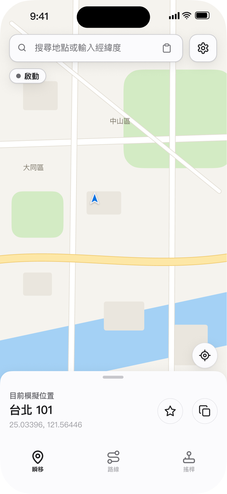
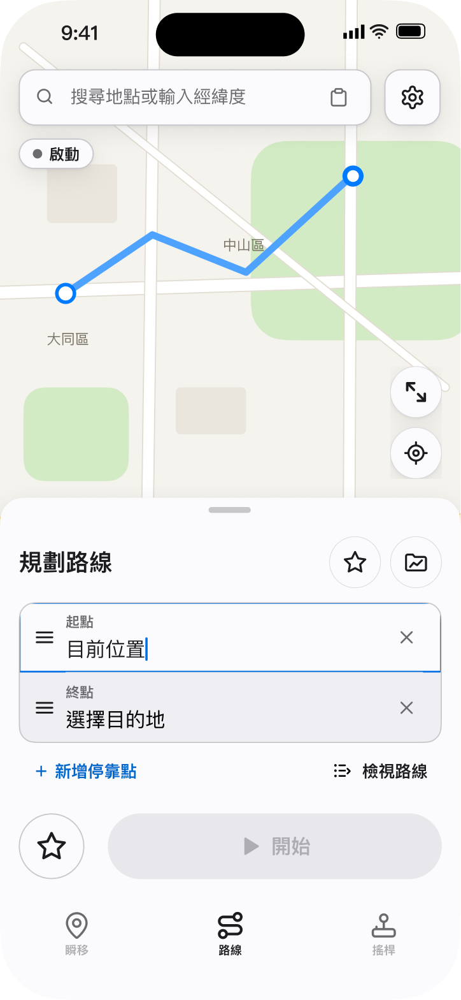
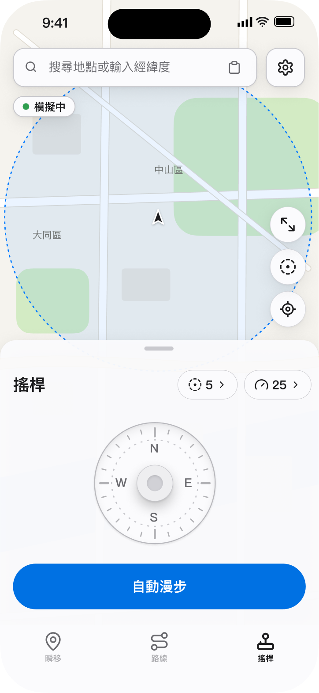
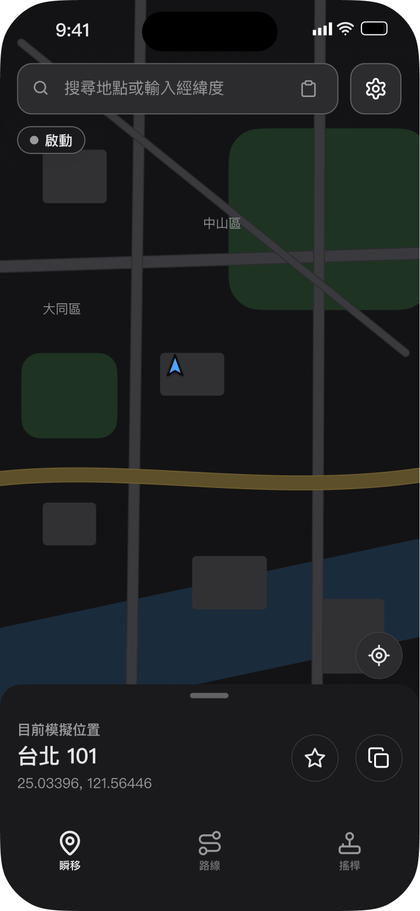
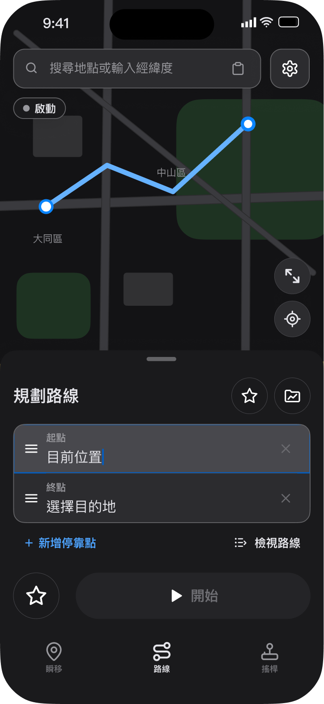
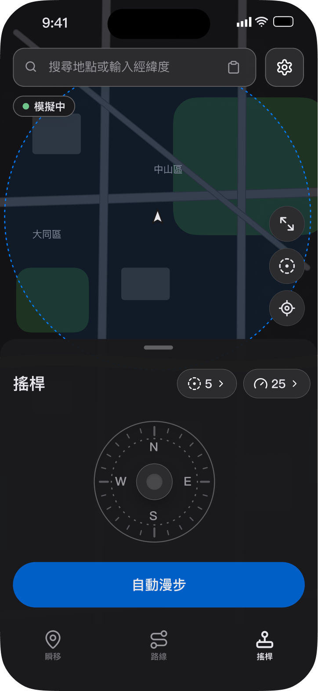

# GoFly GPS


[English](README.md) · **繁體中文** · [简体中文](README.zh-Hans.md)

GoFly GPS 是一個讓你在自己的 iPhone 上選擇並移動模擬 GPS 位置的 App。**GoFly GPS for Mac** 使用你在 Xcode 登入的 Apple 帳號，透過 USB 安裝 iPhone App，並可更新簽名，讓 App 持續可用。

[**下載最新版 GoFly GPS for Mac（DMG）**](https://github.com/nevenhsu/GoFly-GPS/releases/tag/v1.0.12)

**開發狀態（2026-11-02）：GoFly GPS iOS App 已開發完成。** 可透過 GoFly GPS for Mac 安裝，或使用 SideStore／AltStore 安裝 IPA。已知限制與尚待驗證項目見下方說明。

## iPhone App 的功能

**Light 外觀**

<div style="overflow-x: auto; white-space: nowrap;">
  &nbsp;&nbsp;&nbsp;&nbsp;
</div>

<br>

**Dark 外觀**

<div style="overflow-x: auto; white-space: nowrap;">
  &nbsp;&nbsp;&nbsp;&nbsp;
</div>

<br>

- **地圖與搜尋**：搜尋地點並跳轉過去，介面參考 Google Maps 的版面。
- **瞬移**：把模擬位置移到指定的點，並維持在那裡。
- **路線**：在多個點之間規劃路線（含道路路線）、儲存、匯入 GPX，並以步行、自行車、機車或汽車的速度執行。
- **搖桿**：用畫面上的搖桿手動操控移動。
- **漫步**：沿著道路自動行走，可隨時手動接管。
- **最愛與已存路線**：保存在手機上，重新簽名時資料會保留。
- **狀態與復原**：狀態膠囊顯示連線狀態；App 會自動重新連線，也可手動重試、停止或**還原真實 GPS**。
- **語言**：英文、繁體中文、簡體中文。

裝置通道使用 [LocalDevVPN](https://apps.apple.com/us/app/localdevvpn/id6755608044)，需另外從 App Store 安裝。

## Mac App 的功能

GoFly GPS for Mac 不是定位工具。它用**你的** Xcode 簽名 Team 建置 iPhone App、安裝到你連接的 iPhone、交付 iPhone App 需要的配對與裝置支援，並且要等 iPhone 回報後才顯示完成。之後可以經由 USB 或 Wi‑Fi **延長簽名**；Mac App 開著時，簽名快到期會自動延長。延長簽名時 App 內的資料會保留。

## 需求

| 項目 | 需求 |
| --- | --- |
| Mac | Apple Silicon，macOS 15 以上（需符合你 Xcode 的要求）。 |
| Xcode | 從 App Store 安裝完整 Xcode 並下載 iOS 平台。全新 Mac 上 GoFly GPS 會逐步引導。 |
| Apple 帳號 | 你自己的帳號，在 Xcode → Settings → Apple Accounts 登入。免費 Personal Team 即可。GoFly GPS 不會取得你的密碼。 |
| iPhone | iOS 26 以上、已解鎖；首次安裝需 USB 資料線、開啟**開發者模式**，並信任這部 Mac。 |
| iPhone App | 已安裝 [LocalDevVPN](https://apps.apple.com/us/app/localdevvpn/id6755608044) 並允許新增 VPN。 |
| 網路 | Apple 簽名與地圖搜尋需要。 |

免費 Personal Team 的簽名通常約七天到期；讓 Mac App 保持開啟會自動延長，也可按 **Renew Signing**。Mac App 顯示的到期日在你於自己的裝置驗證前，僅供參考。

## 安裝（DMG）

1. 到[最新版 Release](https://github.com/nevenhsu/GoFly-GPS/releases/tag/v1.0.12)，把 `GoFly-GPS-<版本>-arm64.dmg` 與 `GoFly-GPS-<版本>-arm64.dmg.sha256` 下載到同一個資料夾。
2. 核對下載檔案，結果必須是 `OK`：

   ```sh
   shasum -a 256 -c GoFly-GPS-1.0.6-arm64.dmg.sha256
   ```
3. 開啟 DMG，然後**在「終端機」執行安裝腳本**（macOS 會擋下雙擊 `install.sh`）：

   ```sh
   bash /Volumes/GoFly/install.sh
   ```

   它只會安裝 `/Applications/GoFly.app`，已有舊版時會先詢問，並移除該 App 的下載隔離屬性後開啟。不使用 `sudo`、不更動 Gatekeeper、不動 GoFly GPS 的資料。出現提示時輸入 `y` 並按 **Enter**。
4. 在 GoFly GPS for Mac 依畫面步驟準備 Xcode，然後用 USB 連接 iPhone、信任這部 Mac、開啟開發者模式，按**安裝 GoFly GPS**。
5. 在 iPhone 上信任開發者（設定 › 一般 › VPN 與裝置管理）、安裝並允許 LocalDevVPN，再開啟 GoFly GPS。Mac App 讀回 iPhone 的確認後才算完成。

這個 App 使用 ad-hoc 簽署、**未經公證**，所以不能直接雙擊開啟，請用上面的安裝腳本。若你自己拖曳 App，請執行 `xattr -dr com.apple.quarantine /Applications/GoFly.app`。

## 用 SideStore 或 AltStore 安裝 IPA

不想用 Mac App 時，可以用 [SideStore](https://sidestore.io) 或 [AltStore](https://altstore.io) 以你自己的 Apple ID 重新簽名並安裝 IPA。兩者使用同一份 IPA，第一次開啟時要匯入這支 iPhone 的配對檔。 也可以[在 LiveContainer 內執行 GoFly](#在-livecontainer-內執行-gofly-gps)。

**準備**

- iPhone：iOS 26 以上，已開啟**開發者模式**。
- 已安裝 [LocalDevVPN](https://apps.apple.com/us/app/localdevvpn/id6755608044) 並允許新增 VPN；使用 GoFly GPS 時連上 Wi‑Fi。
- 一台有 USB 資料線的電腦，安裝 [iloader](https://github.com/nab138/iloader/releases/latest) 和 [idevice_pair](https://github.com/jkcoxson/idevice_pair/releases/latest)，用於安裝與配對。

**安裝（SideStore `.ipa` 流程）**

1. 從[最新版 Release](https://github.com/nevenhsu/GoFly-GPS/releases/latest)下載 `GoFly-GPS-<版本>.ipa` 與同名 `.sha256`，核對校驗碼（結果須為 `OK`）：

   ```sh
   shasum -a 256 -c GoFly-GPS-<版本>.ipa.sha256
   ```

   核對無誤後，把 `.ipa` 傳到 iPhone（AirDrop、iCloud 雲碟或「檔案」App）。
2. 依下方[流程設定 LiveContainer 與內建 SideStore Nightly](#livecontainer-與內建-sidestore-nightly-安裝設定)，或參考[獨立版 SideStore 的官方安裝說明](https://docs.sidestore.io/docs/installation/install)。
3. 確認 Wi‑Fi 與 **LocalDevVPN** 仍保持連線，在 SideStore 的 **My Apps → ＋** 選擇剛剛傳入的 `GoFly-GPS-<版本>.ipa`，等待重新簽名與安裝完成（若系統要求，請到「設定 › 一般 › VPN 與裝置管理」信任開發者）。
4. 免費 Apple ID 的簽名約 7 天，請保持 Wi‑Fi 與 LocalDevVPN 連線，定期在 SideStore 重新整理 SideStore 與 GoFly GPS；重新整理會保留 App 內的資料，請勿卸載。

若改用 **AltStore**：依 [AltStore 說明](https://faq.altstore.io/)在電腦安裝 AltServer、在 iPhone 安裝 AltStore，同樣在 **My Apps → ＋** 選擇已核對的 `.ipa` 安裝，並定期重新整理。

### 在 LiveContainer 內執行 GoFly GPS

1. 完成 [LiveContainer 與內建 SideStore Nightly 設定](#livecontainer-與內建-sidestore-nightly-安裝設定)並匯入簽署憑證。請使用包含 LiveContainer 區域網路修正的 GoFly IPA。
2. 在 **LiveContainer → Apps → ＋** 選取已校驗的 GoFly IPA，完成後從 LiveContainer 的 Apps 清單開啟 GoFly。
3. 先連上 **LocalDevVPN**，再依下方步驟匯入配對檔及完成引導。如果區域網路步驟跳到設定，請到 **設定 → 隱私權與安全性 → 區域網路 → LiveContainer** 開啟權限，回到 GoFly，必要時再點一次 **Allow**。若配對檔的選檔器打不開，在 LiveContainer 內的 GoFly 個別設定啟用 **Fix File Picker**。[LiveContainer 安裝與相容性說明](https://github.com/LiveContainer/LiveContainer#features--guides)

**背景路線與漫步。** 在 LiveContainer 的 **Apps** 長按 GoFly，開啟 **Settings** 並啟用 **Fix Background Processing Tasks**（修復后台處理任務）。重開 GoFly，再啟動一次路線或漫步。[LiveContainer 相容性修正](https://github.com/LiveContainer/LiveContainer/issues/1710)

本版 IPA 包含 LiveContainer 區域網路修正，仍待本版完整實機驗收。

### 第一次開啟 GoFly GPS

1. 在 idevice_pair 選取這支 iPhone，選 **Remote Pairing** 並儲存檔案。傳到 iPhone 後，先連上 **LocalDevVPN**，再到 GoFly GPS 點**匯入配對檔**，選取 `.plist` 或 `.pairfile`。若出現區域網路權限提示，請允許，首次檢查逾時可再試一次。下方內建 SideStore 步驟匯出的同一份 Remote Pairing 檔也可使用。
2. 依序允許定位與區域網路，並連上 LocalDevVPN；若 App 提示下載裝置支援（DDI），保持網路連線依畫面指示完成即可開始使用。

Remote Pairing 檔若未包含裝置 UDID，GoFly 會透過 LocalDevVPN 驗證這支 iPhone 後才儲存。本版的配對檔匯入流程尚待實機驗收。IPA 版不需要 Mac App；Mac 安裝版仍使用原本的 USB 配對流程。2026-11-02 已用 SideStore 實機驗證匯入、瞬移、路線背景移動，以及手機重開機後的定位；已修正自動漫步在背景運行的問題（背景中一段走完時，原地等待下一條道路規劃完成，不再暫停），已實機測試成功。

### LiveContainer 與內建 SideStore Nightly 安裝設定

在電腦下載最新版 [iloader](https://github.com/nab138/iloader/releases/latest) 和 [idevice_pair](https://github.com/jkcoxson/idevice_pair/releases/latest)，並在 iPhone 安裝 [LocalDevVPN](https://apps.apple.com/us/app/localdevvpn/id6755608044)。Remote Pairing 需要 iOS 17.4 或更新版。GoFly GPS 仍需要 iOS 26 或更新版。

#### 安裝 Nightly

1. 若已有 LiveContainer 資料，先備份並保留原 App。
2. 用 USB 將 iPhone 接到電腦，解鎖後依提示點「信任這部電腦」。
3. 開啟 iloader，選取 iPhone，登入 Apple ID，安裝 **LiveContainer + SideStore（Nightly）**。[官方安裝說明](https://livecontainer.github.io/docs/installation/lc_sidestore#method-2-iloader)
4. 在 iPhone 的「設定 → 一般 → VPN 與裝置管理」信任開發者，並依提示重新啟動。若尚未啟用開發者模式，到「設定 → 隱私權與安全性 → 開發者模式」啟用並依提示重新啟動。

#### 使用 idevice_pair 建立並匯入 Remote Pairing 配對檔

1. 完全關閉 LiveContainer。保持 USB 連線，讓 iPhone 解鎖並停在主畫面。
2. 在 **idevice_pair** 選取 iPhone，選擇 **Remote Pairing／RPPairing**，點 **Create** 並依提示完成配對。點 **Validate** 確認成功，再點 **Save to file…** 儲存並將檔案傳到 iPhone。
3. 開啟 LiveContainer 的內建 SideStore，在配對提示中選取新檔，或從 **Settings → Pairing File Management → Remote Pairing File** 匯入。
4. 若顯示 **Set as Preferred**，將 Remote Pairing 設為偏好協定。完全關閉 LiveContainer，再重新開啟。

匯入只包含 Remote Pairing 的配對檔，可避免混合格式引發的辨識問題，例如 `The pairing file format is ambiguous`。[SideStore 配對回報 #1611](https://github.com/SideStore/SideStore/issues/1611)

#### 登入前設定 Anisette

GoFly 維護者在內建 SideStore 登入時先遇到 HTTP 403，接著遇到 HTTP 503。依序完成以下兩段設定後成功登入。伺服器端變動仍可能影響登入。

1. **HTTP 403｜關閉裝置端 Anisette 並同步遠端設定。** 在內建 SideStore 開啟 **Settings → User Customizations**，關閉 **On-Device Anisette**。若有重新啟動提示，完全關閉 LiveContainer 後重開。
2. 前往 **Settings → Anisette Servers**，選擇可用的遠端伺服器。預設伺服器可用時也可保留。
3. 前往 **Settings → User Customizations → Anisette Client Configuration → Remote Server Sync**，點 **Fetch**，成功後點 **Save as Overrides**。SideStore 社群也曾回報用這組設定處理 401。[401 回報 #1752](https://github.com/SideStore/SideStore/issues/1752)
4. **HTTP 503｜檢查 Client Info。** 若有 `macOS;`，只把這段改成 `Mac OS X;`，保留原本的裝置型號、版本與括號內容。若已是 `Mac OS X;`，直接保留。點 **Save Overrides** 後完全關閉並重開 LiveContainer。[503 回報 #1749](https://github.com/SideStore/SideStore/issues/1749)

**先 Fetch 並儲存，再檢查 Client Info。** 之後每次重新 Fetch 都要再檢查一次，同步可能覆寫設定。

#### 登入、刷新並匯入憑證

1. 在內建 SideStore 使用與 iloader 相同的 Apple ID 登入，完成雙重認證。
2. 連上 **LocalDevVPN**，回到內建 SideStore，點 **My Apps → Refresh All** 並確認成功。
3. 退出內建 SideStore，回到 LiveContainer，前往 **Settings → Import Certificate from SideStore** 並確認。按鈕變成 **Remove Certificate** 代表匯入成功。
4. 開啟 **JIT-Less Mode Diagnose** 確認設定狀態。[官方安裝後設定](https://livecontainer.github.io/docs/installation/lc_sidestore#setup-after-installing)

開發者執行 `bash app/GoFly/scripts/package-ipa.sh` 產生未簽名 IPA 與 SHA-256（需要 Mac、安裝在 `/Applications/Xcode.app` 的 Xcode 與網路）。首次執行（或原生程式庫固定版本變更後）會自動取得固定版本的 idevice、下載經 SHA-256 校驗的 Rust 工具鏈，並在 `work/gofly-ios/` 建置原生程式庫；之後會重複使用。輸出一律放在 `work/dist/ipa/`；同版本的舊 IPA 與校驗檔會先移到 `work/dist/ipa/archive/<UTC 時間>/`，不會被覆蓋或刪除。腳本不更動 Mac 建置。

## 每天晚上自動刷新內建 SideStore

### 1. 先按照官方說明手動建立 Refresh All Apps 捷徑

1. 在「捷徑」App 建立新捷徑。
2. 點 **搜尋動作**，搜尋 **LiveContainer**。
3. 加入 **Refresh All Apps**。若找不到這個動作，先從 LiveContainer 內開啟一次 SideStore 再搜尋。[LiveContainer 自動刷新說明](https://livecontainer.github.io/docs/installation/lc_sidestore#auto-refresh-shortcut)

### 2. 用 prompt 建立自動化

在「捷徑」App 開啟 **自動化**，建立新的自動化並貼上這段 prompt：

```text
建立一個名為「LiveContainer 自動重簽」的自動化捷徑。
1. 每天晚上10點
2. 取得目前連線的 Wi‑Fi 網路名稱（SSID）。如果沒有取得名稱，就結束捷徑。
3. 使用 LocalDevVPN 的連線動作開啟 VPN，然後等待 5 秒。
4. 執行「Refresh All Apps」動作，
   讓 LiveContainer 內建的 SideStore 重新簽署並刷新 App。
```

Refresh All Apps 本身就會顯示通知，自動化不需要再加通知。

建立好之後先手動執行一次，iOS 會跳出確認，詢問是否允許這個自動化捷徑執行其他捷徑（Refresh All Apps），請點允許，否則排程時無法呼叫。之後再在 iPhone 鎖定時測試排程執行。LiveContainer 有回報指出，若未開啟過內建 SideStore，刷新動作可能失敗。[LiveContainer issue #1572](https://github.com/LiveContainer/LiveContainer/issues/1572)

## 把 LiveContainer 內的 App 加到主畫面

### 1. 準備

- 在 LiveContainer 長按要加入的 App（例如 GoFly GPS），點 **Save App Icon**（儲存 App 圖示）存到 iCloud 雲碟。
- 再長按同一個 App，點 **Copy Launch URL**（複製啟動網址）。

### 2. 建立 iOS 捷徑

- 開啟 iPhone 內建的「捷徑」App，點右上角「+」新增捷徑。
- 在下方搜尋列尋找並加入 **Launch App**（LiveContainer 專屬動作，安裝 LiveContainer 時需勾選啟用 `LaunchAppExtension` 擴充功能）。
- 點動作中的欄位，貼上剛剛複製的啟動網址。[LiveContainer 說明](https://livecontainer.github.io/zh-CN/docs/guides/add-to-home-screen)
- 點上方的捷徑名稱，改成 App 名稱（例如 GoFly GPS）。

### 3. 加入主畫面並設定圖示

- 點捷徑下方的分享按鈕，選擇「加入主畫面」。
- 點預設圖示並選擇「選擇檔案」，挑選剛才存好的 App 圖示，改成對應的名稱後按「加入」即可完成。

## 讓 AI 幫你安裝

把 GitHub 網址連同下面的 prompt 貼給能執行 shell 指令（最好也能操作你的電腦）的 AI 助理：

**透過 Mac App（DMG）安裝：**

```text
請幫我從 https://github.com/nevenhsu/GoFly-GPS 安裝 GoFly GPS。

1. 先讀該專案的 README.md 與 docs/AI-INSTALL.md。
2. 不要從原始碼建置。把最新 Release 的 GoFly-GPS-<版本>-arm64.dmg 與 .sha256
   下載到一個全新的空資料夾（例如用 `gh release download`），執行
   `shasum -a 256 -c`，結果不是 OK 就停止。
3. 掛載 DMG，在終端機執行 `bash /Volumes/GoFly/install.sh`。不要雙擊、不要用
   sudo、不要關閉 Gatekeeper。出現取代提示時，必須我確認才回答 y。
4. 開啟 GoFly GPS for Mac，帶著我逐步操作。Apple 登入、雙重認證、鑰匙圈密碼提示、
   iPhone 信任、開發者模式、VPN 權限與安裝 LocalDevVPN 由我自己處理。不要要求我把
   密碼、配對檔或 token 貼到聊天裡。
5. 不要卸載任何東西、不要刪除 App 資料。中斷時使用 App 內的「重新開始」，不要自行
   想辦法接續。
6. 回報已完成的項目、我還要在 iPhone 上做的事，以及阻礙。安裝成功不代表模擬定位
   一定可用，請另外說明。
```

**透過 SideStore 安裝 `.ipa`：**

```text
請幫我透過 SideStore 從 https://github.com/nevenhsu/GoFly-GPS 安裝 GoFly GPS（IPA）。

1. 先讀該專案的 README.zh-Hant.md 與 docs/AI-INSTALL.md。
2. 不要從原始碼建置。把最新 Release 的 GoFly-GPS-<版本>.ipa 與 .sha256
   下載到一個全新的空資料夾，執行 `shasum -a 256 -c`，結果不是 OK 就停止。
3. 依 README 的 LiveContainer + SideStore Nightly 流程引導我使用 idevice_pair 完成
   Remote Pairing，並在登入前設定 Anisette。接著在 SideStore（My Apps -> +）
   安裝 GoFly GPS IPA，並在首次開啟 GoFly GPS 時匯入這支 iPhone 的 Remote Pairing 配對檔。
4. 若 Apple ID 登入失敗，依 README 中對應的疑難排解處理（電腦上的 iloader 或內建 SideStore）。
5. Apple ID 登入、雙重認證、iPhone 信任、開發者模式與 VPN 權限由我自己處理；不要要求我
   在聊天裡提供密碼、配對檔或 token。
6. 回報已完成的項目、我還要在 iPhone 上做的事，以及阻礙。安裝成功與模擬定位可用請分開說明。
```

給 AI 助理的完整操作說明在 [docs/AI-INSTALL.md](docs/AI-INSTALL.md)。

## 疑難排解

| 症狀 | 處理方式 |
| --- | --- |
| 「Apple 無法驗證 install.sh…」 | 不要雙擊。在終端機執行 `bash /Volumes/GoFly/install.sh`。 |
| `/Volumes/GoFly/install.sh: No such file` | DMG 沒有掛載，或掛著舊的。在 Finder 退出 `GoFly GPS` 磁碟映像，再開啟新的 DMG。 |
| `install.sh` 停在提示不動 | 輸入 `y` **後要按 Enter**。 |
| 找不到 iPhone | 使用資料線、解鎖手機、點「信任」、開啟開發者模式（需重新開機）。 |
| 「無法完成安裝前檢查」 | 按**再檢查一次**。若手機上已有 GoFly GPS，點側欄的裝置，使用 **Renew Signing**。 |
| iPhone 上的 App 打不開 | 簽名已過期。從 Mac App 或 SideStore／AltStore 延長簽名，資料會保留。 |
| LocalDevVPN 已開但 GoFly GPS 無法繼續 | 確認 VPN 實際已連線且已允許，再回 GoFly GPS 重試。 |
| 在 LiveContainer 內使用 GoFly 時出現「背景執行遭拒」 | 在 LiveContainer 的 **Apps** 長按 **GoFly GPS**，點 **Settings**，開啟 **Fix Background Processing Tasks**。重新開啟 GoFly，再啟動路線或漫步。若找不到開關，請更新 [LiveContainer Nightly](https://github.com/LiveContainer/LiveContainer/releases/tag/nightly)。 |
| 內建 SideStore 登入出現 HTTP 403 | 關閉 **On-Device Anisette**，選擇可用的遠端伺服器，執行 **Fetch → Save as Overrides**。接著檢查 Client Info。[登入前設定 Anisette](#登入前設定-anisette) |
| 內建 SideStore 登入出現 HTTP 503 | 先 Fetch 並儲存，再檢查 **Client Info**，只將 `macOS;` 改成 `Mac OS X;`。[登入前設定 Anisette](#登入前設定-anisette) |
| 電腦上的 iloader 無法登入 Apple ID | iloader 2.4.1 可能回傳 HTTP 503，2.4.2 在部分帳號可能回傳 `-22410` 或 `-23782`。GoFly 維護者使用自行打包的 [iloader PR #1205](https://github.com/nab138/iloader/pull/1205) 版本。也可以等包含登入修正的 [iloader 官方新版](https://github.com/nab138/iloader/releases/latest)。 |
| SideStore 安裝或刷新時出現「Operation Failed … unable to reach the device endpoint … `DeviceEndpointNotInitialized`」 | LocalDevVPN 顯示已連線，但 SideStore 透過它連不到這支 iPhone。**重啟 iPhone**，重新連上 Wi‑Fi 與 LocalDevVPN 後，再回 SideStore 重試。 |

## 從原始碼建置

只有開發時需要。在安裝了完整 Xcode 的 Apple Silicon Mac 上：

```sh
bash app/GoFlyMac/make-dmg.sh <你的_XCODE_TEAM_ID>
```

會產生 `work/dist/GoFly-GPS-<版本>-arm64.dmg` 與 `.sha256`（不納入版本控制）。詳見 [app/GoFlyMac/README.md](app/GoFlyMac/README.md)、[app/GoFly/README.md](app/GoFly/README.md) 與 [docs/MAC-INSTALLER-SPEC.md](docs/MAC-INSTALLER-SPEC.md)。

## 現況與限制

- 第一版只支援 Apple Silicon Mac；不含 Intel Mac、公證、備份／還原。
- 乾淨 Mac 驗收與長時間實機測試尚未完成；安裝成功不代表每台裝置的背景運行、重新連線或 GPS 還原都正常。請在自己的 iPhone 上測試，並確認事後真實位置已還原。
- 只在你自己擁有的裝置上使用 GoFly GPS，並遵守當地法律與你測試的 App 的服務條款。

## 文件

| 路徑 | 用途 |
| --- | --- |
| [docs/AI-INSTALL.md](docs/AI-INSTALL.md) | 給 AI 助理的安裝操作說明。 |
| [docs/MAC-INSTALLER-SPEC.md](docs/MAC-INSTALLER-SPEC.md) | Mac App 流程與行為。 |
| [docs/IOS-UI-DESIGN.md](docs/IOS-UI-DESIGN.md) | iOS UI 設計與驗收。 |
| [docs/LICENSING.md](docs/LICENSING.md) | 授權與來源。 |

## 授權

新撰寫、獨立擁有的內容（根目錄 README 與 `docs/` 下的指南）採用 **0BSD**，見 [LICENSE](LICENSE)。這不會重新授權既有的 App 程式碼或相依套件。源自 LocalGo/StikDebug 的部分保留 AGPL-3.0 聲明，Mac App 內附 GPL-3.0 的 `pymobiledevice3`，因此合併發行不能說成完全免署名。詳見 [docs/LICENSING.md](docs/LICENSING.md) 與 [app/GoFly/Legal/SOURCES.txt](app/GoFly/Legal/SOURCES.txt)。GoFly GPS 不使用也不散布 AnyGo／iToolab 的程式碼、素材或服務。
